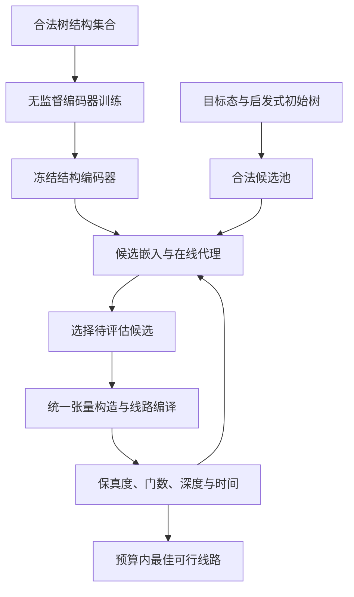

# 学习式 TTN 结构搜索：整体方案、实现细节与实验流程

版本：v1.2  
日期：2026-10-20  
状态：研究设计与建议配置，尚未开展本文规划的实验；文中数值不是已有结果。

本次修订：重点加入随机树、SCENT 树及其扰动的混合预训练数据设计，明确来源比例、生成与去重、目标分组隔离、成本和数据清单；补充混合预训练与混合在线候选的四组消融，以及模型复用的准确范围。保留 v1.1 中 BO、最终系统及全局误差控制的设计。

## 1. 研究目标与已经确定的范围

本课题的核心主张是：**在相同的张量构造与线路编译流程下，学习模型辅助选择的 TTN 结构，能够生成成本更低的高保真量子态制备线路。**

输入是一个可在经典计算机上访问的目标态或振幅函数，输出是制备该态的量子线路。TTN 作为编译中间表示；目标态不必一开始就以 TTN 给出，也不要求所有输入都先转换为 MPS。

第一版采用“无监督结构表示学习＋少量真实编译反馈＋贝叶斯优化”的路线。预训练学习如何表示树，在线搜索学习哪些树适合当前目标态。先在合法候选集合中搜索，再考虑动态扩展候选或逐步生成树。

预训练数据采用以随机树为主、少量 SCENT 树及其扰动为辅的拟议混合方案。SCENT 提供结构样本，不提供性能标签；这种混合是否优于全随机预训练，必须通过独立消融确认。在线候选也可混合随机树与当前目标的 SCENT 树，但它与预训练数据混合是两个不同模块。

本课题不预设以下结论：

- TTN 在所有态上优于 MPS。
- 学到的树一定具有最小的张量参数量。
- 无监督学习能够取消候选编译和性能验证。
- 一个模型能够直接跨任意系统规模或任意态族泛化。
- 把已有 QAS 方法迁移到 TTN 就足以形成顶刊贡献。

不沿用此前的逐键门数预算分配。第一阶段不同时训练线路生成模型，不开展后验剪枝课题，也不将贪心解纠缠的长期影响设为研究主线。内部张量秩由所有方法共享的精度控制程序确定，不是学习动作。

研究成功应体现为：在明确的目标态范围和可比经典计算预算下，学习方法改善最终线路的保真度—CNOT—深度关系。若只减少搜索时间而未改善可达到的线路质量，应如实调整贡献表述。

## 2. 文献来源、可借鉴部分与边界

### 2.1 SCENT：研究的直接出发点

Sims-Goh 等的 *Multivariate quantum state preparation with optimized tensor networks* 提出 SCENT，以成对关联／纠缠指标构造亲和矩阵，经递归谱聚类选树，再通过张量交叉插值和近似线路综合完成态制备。[R1]

本课题保留其“选树影响最终态制备”的出发点，探索学习得到的结构表示能否支持更有效的线路成本驱动搜索。不能把自动选树、TTN 态制备或规范自由度的利用本身作为新增贡献。

截至本方案日期，查到的 SCENT 版本为 arXiv:2609.09304v1，未查到正式期刊记录。可直接引用和比较该预印本。论文给出的 SCENT／TCI 代码入口为 `treetensorcomp`，但本方案尚未验证其安装、接口和线路综合模块的公开完整性。正式实验前须核实并固定版本；不能假定完整复现已经完成。[R1]

### 2.2 无监督表示学习的 QAS：方法框架来源

Sun 等的 *Quantum Architecture Search with Unsupervised Representation Learning* 已发表于 Quantum 10, 1994（2026）。它先在不使用性能标签的情况下学习线路图表示，再用 REINFORCE 或贝叶斯优化根据真实任务反馈搜索。[R2]

借鉴的是表示学习与性能搜索的解耦。该文的贝叶斯优化分支仍有在线更新的回归代理；“predictor-free”不代表整个系统没有预测模型或不需要性能评估。我们的方案应称为“无监督结构预训练＋在线代理搜索”，避免产生误解。[R2]

### 2.3 其他必要参照

- Hikihara 等的 TTN 自动结构优化：作为非学习的局部重连基线。[R3]
- Manabe 与 Sano 的多元正态分布 TTN 态制备：作为结构优化应用于线路制备的已发表先例。[R4]
- Sugawara 等的 TTN 浅线路嵌入：作为可评估的编译后端参照。[R5]
- Iten 等的等距映射综合：用于构建局部映射的标准线路实现与校验后端。[R6]

本文后续模型、配置、搜索规则及实验门槛均为拟议设计，不是上述论文已经验证的结论。

## 3. 形式化定义与实验指标

### 3.1 输入与输出

令归一化目标态为 $|\psi\rangle$，系统规模为 $n$。允许三种输入接口：

1. 小系统的完整态矢量，用于精确核验。
2. 可查询振幅的多元函数，配合 TCI 等方法构建 TTN。
3. 已有 MPS 或其他 TN，只在转换与收缩代价可控时使用。

“访问已知经典描述”与“从未知实验量子态学习”不同；本课题不承担量子态层析成本。

候选树 $T$ 是带固定物理叶子标签的有根二叉树。固定构造程序 $A$ 与编译程序 $C$：

$$
|\phi_T\rangle=A(\psi,T;\eta),\qquad
U_T=C(\phi_T;\kappa,H).
$$

其中 $\eta$ 是张量构造与精度控制设置，$\kappa$ 是编译与优化设置，$H$ 是硬件连接图。各方法使用相同的设置和停止规则。改变 $T$ 不允许改变目标态的物理比特含义。

最终线路全局保真度统一使用平方定义：

$$
F_T=|\langle\psi|U_T|0^n\rangle|^2.
$$

主目标为：

$$
\min_T N_{\mathrm{CNOT}}(U_T)\quad\text{s.t.}\quad F_T\ge F_0.
$$

深度作为并列结果报告。确认有稳定信号后，可增加 $D(U_T)\le D_0$ 的约束，扫描 $D_0$ 得到 Pareto 曲线。第一版不使用任意加权和掩盖“降低保真度换门数”的情况。

### 3.2 三类保真度必须区分

- 表示保真度：$F_{\mathrm{repr}}=|\langle\psi|\phi_T\rangle|^2$。
- 编译保真度：$F_{\mathrm{comp}}=|\langle\phi_T|U_T|0^n\rangle|^2$。
- 最终保真度：$F_T$，它决定候选是否满足主任务。

不能用 $F_{\mathrm{repr}}F_{\mathrm{comp}}$ 冒充最终全局保真度，也不能将局部截断保真度的乘积当成未经证明的保证。

小系统直接计算最终态矢量与目标态的重叠。大系统必须先明确全局收缩是否可行；两棵不同拓扑的树叠加后可能产生较难收缩的网络。若只能给估计值或误差界，应明确估计方式、误差范围与阈值判定规则，不将其标为精确保真度。

### 3.3 指标分类

| 层面 | 必须记录的指标 | 用途 |
| --- | --- | --- |
| 最终线路 | 全局平方保真度、最终 CNOT 数、总深度、两比特门深度 | 主结果 |
| 表示 | 张量参数总量、最大秩、表示保真度、构造时间与峰值内存 | 解释机制和资源限制 |
| 搜索 | 编译调用数、累计时间、可行候选比例、达到目标的时间 | 评估搜索效率 |
| 学习 | 预训练时间、结构数据生成时间、模型参数量 | 评估额外开销 |
| 稳定性 | 搜索种子和编译种子引起的波动、失败类型 | 防止随机性造成假优势 |

第一版统一到单比特旋转＋CNOT 门集。全连接只作为理想连接设置；硬件结果须另外计入路由与 SWAP 分解。不用 TTN 高度替代实际电路深度，不用张量元素数直接替代 CNOT 数。

### 3.4 两阶段误差的组合与预算

令 $|\psi_C\rangle=U_T|0^n\rangle$，三个态均为归一化纯态，定义

$$
e_{\mathrm{repr}}=1-|\langle\psi|\phi_T\rangle|^2,\quad
e_{\mathrm{comp}}=1-|\langle\phi_T|\psi_C\rangle|^2,\quad
e_{\mathrm{final}}=1-|\langle\psi|\psi_C\rangle|^2.
$$

对纯态，迹距离 $D(\psi,\phi)=\tfrac12\|\rho_\psi-\rho_\phi\|_1=\sqrt{1-|\langle\psi|\phi\rangle|^2}$。由其三角不等式得到：

$$
\sqrt{e_{\mathrm{final}}}\le\sqrt{e_{\mathrm{repr}}}+\sqrt{e_{\mathrm{comp}}},
$$

因此有保守上界：

$$
\boxed{e_{\mathrm{final}}\le
\min\{1,(\sqrt{e_{\mathrm{repr}}}+\sqrt{e_{\mathrm{comp}}})^2\}.}
$$

这不是误差相加的等式，也不假设误差独立。两阶段各允许 $10^{-3}$ 的 infidelity，只能由此得到至多 $4\times10^{-3}$ 的上界，不能保证最终仍为 $10^{-3}$ 或 $2\times10^{-3}$。

设最终误差要求为 $E=1-F_0$，可预先选取全局阶段预算 $\bar e_{\mathrm{repr}}$、$\bar e_{\mathrm{comp}}$，使

$$
\sqrt{\bar e_{\mathrm{repr}}}+\sqrt{\bar e_{\mathrm{comp}}}\le\sqrt E.
$$

例如 $F_0=0.999$ 时，取 $\bar e_{\mathrm{repr}}=10^{-4}$、$\bar e_{\mathrm{comp}}=4\times10^{-4}$，可保证 $e_{\mathrm{final}}\le9\times10^{-4}$，前提是两阶段实际全局误差确实满足这些预算。

**TCI 的局部插值分解容差、局部门拟合损失和上述全局态误差不是同一个量。** 不能将局部容差直接代入此界。需要真实计算或可靠地界定全局误差；若只有统计估计，应在所述置信水平下使用误差上限，并计入联合验证的不确定性。

该预算控制的是“表示”和“编译”两个阶段，不涉及此前弃用的逐键门数分配。第一轮给所有方法相同的阶段预算和内层调整规则，避免某个结构因被允许更差的最终精度而显得更省门。

SCENT 论文图 9 使用的量是 $1-|\langle\psi_{\mathrm{TTN}}|U|0\rangle|$；本方案使用平方保真度。若前者记为 $\delta$，对应的平方 infidelity 为 $2\delta-\delta^2$。复现比较时须转换定义，并区分“相对于 TTN”的编译误差与“相对于原始目标”的最终误差。[R1]

## 4. 总体架构与模块边界

整体分为离线结构学习与在线目标搜索两部分。



关键接口：

```python
Tree = rooted_binary_tree_with_labeled_leaves

encode_structure(tree) -> embedding
construct_target_ttn(target, tree, build_config) -> ttn_result
compile_ttn(ttn_result, compiler_config, seed) -> circuit_result
verify_circuit(target, circuit_result, verify_config) -> metrics
evaluate_candidate(target, tree, frozen_pipeline, seed) -> EvaluationRecord
```

结构编码不应调用 `construct_target_ttn` 或 `compile_ttn`。否则所谓无性能标签预训练可能暗中包含昂贵的目标态计算。

### 4.1 三类模块及其训练信号

输入是图的邻接关系、方向和节点属性，不是树的绘图图像。TTN 可以表示为 DAG，但采用 GIN 时仍需显式处理根方向与物理叶标签；“属于 DAG”本身不保证结构被正确区分。

| 模块 | 输入与输出 | 学习信号 | 新目标到来时 |
| --- | --- | --- | --- |
| 结构编码器 $E_\theta$ | 树 $T$ → 结构向量 $z_T$ | 无监督／自监督结构重建 | 冻结并复用 |
| 重建头 $D_\phi$ | $z_T$ → 层级关系等结构信息 | 与原始结构的重建误差 | 候选池搜索中可以停用 |
| 在线性能代理 $g_\psi$ | $z_T$ → 成本、可行性及不确定性 | 当前目标的真实编译观测 | 第一版重新拟合并持续更新 |
| 采集规则 | 代理预测与当前最佳结果 → 下一候选 | 没有独立的结构重建损失 | 随搜索数据选择评估对象 |

预训练关系为 $T\rightarrow E_\theta(T)\rightarrow D_\phi(E_\theta(T))$，损失只针对结构。线上代理通过回归拟合已观测性能，例如 GP 的边际似然优化；约束 EI 决定后续评估，不是整个系统共同反向传播的损失函数。线路的保真度与门数是在线任务目标。

若改用 RL，策略依据编译反馈构造的奖励更新，但仍不意味着必须同时用该奖励重新训练结构编码器。是否微调编码器是独立实验。

最终可复用的产物是结构编码器、候选生成规则、搜索与编译程序。当前目标上的性能代理不自动成为适用于所有目标的通用评分器。整个方法也不是完全无监督：只有结构预训练不需要性能标签，在线阶段需要真实性能反馈。

### 4.2 原型、最终系统与后续扩展

最终系统定义为：**接收一个新目标态、最终保真度阈值和经典搜索预算，输出预算内找到且通过验证的 TTN 与制备线路。** 不承诺一次前向传播得到全局最优结构。

| 部分 | 最小原型 | 建议的最终系统 |
| --- | --- | --- |
| 结构表示 | 固定规模的小型无监督编码器 | 经独立测试验证的可复用编码器 |
| 候选空间 | 预先冻结的合法树集合 | 初始树、优胜树邻域重连与新结构探索 |
| 选择机制 | 小预算约束 BO | 预算约束、动态候选扩展与停止规则完整的 BO |
| 张量与线路后端 | 小系统确定性校验流程 | 固定的 TCI＋SCENT 类近似线路编译流程 |
| 输出 | 固定池内最佳可行候选 | 实际搜索过的候选中最佳可行 TTN、线路与验证记录 |

建议最终在线步骤：获得 SCENT 等初始树 → 生成候选并编码 → 评估少量初始点 → 更新代理 → 选择新树并真实编译 → 围绕有希望的结构扩展候选，同时探索新结构 → 预算结束后验证并输出。

BO 可以保留为最终算法，不存在“原型必须 BO、最终必须 RL”的规定。若固定候选池已提供充分、可解释的结果，也可构成完整论文版本，不为增加复杂度而强制加入动态生成。

“输入目标态，模型一次生成树”属于不同的后续目标，需要目标条件编码／策略与跨目标训练。只有在在线搜索成本已成为明确瓶颈、且有可复用的跨目标经验时再尝试，不将其视为本方案必然达到的能力。

## 5. 树的表示、候选生成与去重

### 5.1 树结构的精确定义

每棵树有 $n$ 个物理叶子和 $n-1$ 个内部节点，根节点具有两个孩子。第一版固定根的制备方向；根位置变化作为结构的一部分，不随意在比较过程中重选。

物理叶子标签必须保留。例如 `((0,1),(2,3))` 与 `((0,2),(1,3))` 的无标签拓扑相同，但物理划分不同，必须视为不同候选。

只消除内部编号和左右孩子显示顺序造成的重复。推荐规范字符串：叶子编码为 `q0`、`q1` 等；内部节点递归编码后，将两个孩子的字符串按固定规则排序，再组合并哈希。哈希中加入根结构及叶子标签。

### 5.2 第一版候选来源

每个目标使用一套冻结的候选池，起始可取 128–256 棵，资源允许再增至 512 棵：

- SCENT 输出及若干合法重连邻居。
- 平衡树、链式／梳状树，以及不同叶子排列。
- 适用的熵驱动局部结构优化结果。
- 随机二叉合并树与局部重连树。

推荐先将随机来源、当前目标的 SCENT 原树和其邻域候选组成混合池。在线比例不直接照搬预训练的 70%／10%／20%：对一个目标通常只运行一次 SCENT，保留其唯一原树，其余名额由随机树与去重后的邻域树分配。候选生成本身不构造所有树对应的目标张量、不编译所有候选。

当前目标上的 SCENT 是在线启发式计算，需要计时；它不是预训练必需依赖。全随机在线候选作为对照必须保留。SCENT 树的邻居不保证具有低秩或低编译成本。

所有候选在构造任何昂贵张量前检查合法性和去重。随机树生成策略须记录；简单随机合并不等价于在所有带标签二叉树上均匀采样，不作此宣称。

SCENT 若在变量寄存器层面选树，而我们的搜索在比特层面开展，应先固定共同层级：第一版使用一致的分组单位与寄存器内部展开规则。只有明确作为扩展实验时才开放新的分组自由度，避免把搜索空间变大误归因为学习方法更好。

### 5.3 固定候选池和动态扩展的区别

固定池便于各搜索算法面对完全相同的选择空间，也能缓存真实评估用于算法诊断。其最优值仅是“候选集合中的最佳”，不是所有树中的全局最优。

动态扩展在第二阶段开启：围绕当前优胜树进行合法局部重连，同时保留一定比例的新结构探索；全程去重。此时必须给非学习搜索算法相同的重连算子和候选生成预算。

## 6. 无监督 TTN 结构表示模型

### 6.1 最小可行编码器

建议从有向边类型消息传递的 GIN 变体开始，而非复杂生成模型。实现时区分“父到子”和“子到父”的聚合，避免丢失根方向。可采用：

- 隐藏维度：64 或 128。
- 消息传递层数：4–6，开发集选定后冻结。
- 全图读出：根节点表示与全图均值／最大池化拼接。
- 潜在维度：8 或 16，低维优先，便于小样本代理拟合。

节点输入包含叶／内部／根类型、叶子标签 one-hot、相对深度、子树叶子数。第一版不输入目标态张量或实际 bond dimension，因为它们往往需要先构造候选表示。若加入确定性子树成员信息，应同时给手工特征基线同样的信息。

物理叶子 one-hot 使第一版模型限定于固定 $n$，这是有意的范围限制，不宣称跨规模泛化。长梳状树可能超出浅层 GNN 的感受野，应检查其误差；必要时使用双向 Tree-LSTM 或完整向上／向下树遍历编码，不以更深 GNN 作为唯一修复。

### 6.2 第一版自监督任务

采用图编码器＋结构关系重建头，不强制训练可生成任意树的解码器。令根深度为 0，定义：

$$
R_{ij}=\frac{\operatorname{depth}(\operatorname{LCA}(i,j))}{n},\quad i<j,
\qquad d_i=\frac{\operatorname{depth}(i)}{n}.
$$

$R$ 表示每对物理叶子最近公共祖先的深度，$d$ 表示根到叶深度。这些量只依赖结构，易于生成，不需要性能标签。固定 $n$ 时，用小型 MLP 从 $z_T$ 预测 $R$ 的上三角和 $d$。

初始损失：

$$
L_{\mathrm{self}}=\operatorname{MSE}(\widehat R,R)
+\lambda_d\operatorname{MSE}(\widehat d,d),\qquad \lambda_d=1.
$$

第一版可用普通自编码式瓶颈。VAE 的 KL 正则属于后续消融，不因参考论文使用 VAE 就强制引入；候选池搜索不需要从连续潜在空间自由解码。

内部节点重编号、左右孩子互换是应保持表示一致的变化。任意交换物理叶子不能作为“不改变语义”的增强；只有同时变换目标态、硬件映射并明确等变规则时才可讨论这种操作。

### 6.3 结构数据集

#### 6.3.1 预训练混合的目的

随机树提供结构覆盖，SCENT 树使编码器接触实际目标中可能出现的层级组织，SCENT 邻域树提供这些结构附近的变化。预训练只学习如何表示和重建结构，不要求为每棵树求张量、求线路或计算性能。

因此，加入 SCENT 树后仍可称为“无性能标签的结构预训练”。更准确地说，数据分布包含启发式先验，但训练损失仍是结构自监督损失。不能把 SCENT 来源自动标成优质、把随机来源标成劣质。

**熟悉 SCENT 风格的结构，不等于知道它对哪个目标态更好。** 编码器不接收目标态描述时，目标相关判断依然依赖在线反馈。

#### 6.3.2 建议来源比例与规模

每个固定 $n$ 先以 10,000 棵去重结构为目标，资源允许且有收益后再扩展。建议起始比例：

| 来源 | 目标比例 | 10,000 棵时的目标数量 | 作用 |
| --- | --- | --- | --- |
| 随机合法树 | 70% | 7,000 | 覆盖树形、深度与物理叶子分组 |
| SCENT 原树 | 10% | 1,000 | 引入真实任务相关的结构分布 |
| SCENT 原树的局部扰动 | 20% | 2,000 | 表示启发式结构附近的变化 |

70%／10%／20% 是待验证的开发配置，不是最优比例或必须凑齐的配额。比例按去重后样本数统计。若 SCENT 原树大量重复，不能重复复制到 1,000 条；应报告有效数量，在预定生成预算内补充目标，仍不足时用随机结构补足并记录实际比例。

在最初开发实验中可先用总量 2,000 的同比例版本，确认数据管线和训练有效，再扩大到 10,000。不要先为满足比例花大量时间生成 SCENT 数据。

建议通过一个小型四组实验分别判断作用：

| 预训练数据  | 在线候选               | 检验什么                 |
| ----------- | ---------------------- | ------------------------ |
| 全随机      | 全随机                 | 基础方案                 |
| 随机＋SCENT | 全随机                 | 混合预训练是否有帮助     |
| 全随机      | 随机＋当前目标的 SCENT | 在线启发式候选是否有帮助 |
| 随机＋SCENT | 随机＋当前目标的 SCENT | 两者结合是否有额外收益   |

#### 6.3.3 各来源的生成流程

**随机树。** 混合随机二叉合并、随机平衡划分、非平衡树及合法局部重连。改变物理叶子分组并记录生成器类型、种子。只对节点结构进行合法性检查和哈希去重，无需目标态。简单随机合并不是全部树上的均匀采样，应报告生成分布。

**SCENT 原树。** 从预训练目标库采样振幅函数或目标实例，按冻结的 SCENT 设置计算结构。目标库应覆盖链式、层级、交叠关联等预定任务类型。仅运行获取树所必需的特征计算和结构发现，不为了预训练结构样本继续执行 TCI 拟合或线路综合。如果所采用的亲和指标本身依赖昂贵处理，应单列其成本。

一个目标可得到一棵或若干不同树，但多次运行不保证输出不同。只有合法且去重后的结果进入数据集。可改变目标参数扩大结构分布；不根据最终线路效果筛选 SCENT 样本，否则变成隐含的性能标注流程。

**SCENT 扰动树。** 从原树出发，执行 1–3 次合法局部重连作为起点配置，生成近邻和稍远的结构；始终保持叶子标签集合不变。新树不需要重跑 SCENT、不需要重新拟合目标态。它只是结构样本，不继承任何“高质量”保证。给每棵原树设置后代上限，避免一棵树的邻域主导数据集。

交换左右孩子或重新编号内部节点不会形成新候选，应被规范哈希合并。改变物理叶子分组可以形成新结构，但不能当成语义不变的增强。

#### 6.3.4 数据隔离与划分规则

先划分目标库，再生成 SCENT 原树及后代；不要生成完全部扰动后按单棵树随机拆分。建议流程：

1. 预训练目标库按目标／生成家族实例分为训练、验证与结构测试组；同一目标及其轻微参数扰动保持同组。
2. 某个 SCENT 原树的全部扰动后代与原树进入同一组，保留共同的 `lineage_id`。
3. 随机树按独立生成族或哈希分组；从同一个随机祖先得到的近邻也按谱系保持同组。
4. 全局检查规范哈希重复，跨组重复不得同时保留。训练／验证／测试目标比例可取 80%／10%／10%，最终报告实际数量。
5. 最终量子态制备测试目标另设独立集合，不使用这些目标运行 SCENT 来补充预训练样本，也不使用其线路效果选择混合比例。

测试目标在线运行 SCENT 是允许的算法步骤，与测试泄漏不同，但得到的树只能进入该目标的在线候选，不回流用于本轮预训练或超参数选择。最终测试中随机候选偶然与预训练中的同一拓扑重合并非必然泄漏；如果专门主张“未见树结构泛化”，则需另建哈希不重合的测试协议。

#### 6.3.5 训练方式与数据清单

三种来源统一使用第 6.2 节的结构重建任务。默认所有样本相同权重，不把来源标记输入编码器，也不给 SCENT 树额外的性能奖励。若后续采用分层采样，应固定规则并报告有效采样比例。

每个结构保存以下元数据，供去重、隔离与成本核验使用：

```json
{
  "tree_hash": "...",
  "n_qubits": 12,
  "source": "random|scent|scent_perturbation",
  "tree_serialization": "...",
  "generator_name": "...",
  "generator_seed": 0,
  "target_id": null,
  "target_group_id": null,
  "parent_tree_hash": null,
  "lineage_id": "...",
  "perturbation_count": 0,
  "split": "train|validation|structure_test",
  "generation_run_id": "...",
  "scent_config_hash": null
}
```

随机结构的目标相关字段为 `null`。一条谱系的 SCENT 原始生成时间记录在独立 `generation_run` 表中，避免给每个后代重复累加；随机生成、扰动、去重和编码的时间分别统计。

#### 6.3.6 与全随机预训练的公平比较

至少比较相同去重样本总量的“100% 随机”和“拟议混合”。固定编码器、重建任务、优化器和训练更新次数；使用同一结构验证集合评估编码质量，同时用独立目标上的相同在线搜索评价实际价值。两种训练语料都要避免与该结构验证集合哈希重合。

优先选择“在预定预算内达到的最佳可行线路成本”作为判断标准，不能只凭混合数据上的重建误差更低就确认收益。全随机方案可能较便宜且效果相当，此时应采用更简单的全随机预训练。

混合比例只在开发集做有限调整，例如先比较全随机与 70%／10%／20%；有明确信号后再做少量比例敏感性实验，避免大范围调参本身吞掉节省的编译成本。

### 6.4 必须比较的非学习表示

直接把 $R$ 的上三角与 $d$ 拼接作为手工特征，再比较：

1. 标准化后的原始关系特征。
2. 相同维度 PCA 压缩后的关系特征。
3. 无监督 GNN 编码。

这是一条强而便宜的对照。若 GNN 不优于这些特征，就不能宣称复杂结构学习是必要的。结构重建精度高也不保证搜索有效，最终以线路搜索结果判断。

### 6.5 模型复用与结构覆盖的准确表述

训练好的编码器及合法树的嵌入可以复用；第一版在线性能代理针对每个新目标重新拟合。因此，当前可检验的优势是“复用结构表示、摊销预训练开销并提高后续搜索效率”，不是已经得到一个适用于任意目标的通用选树评分器。

已有 SCENT 等算法也能重复运行；区别在于我们复用的是通过数据训练获得的表示。要证明这种复用有价值，必须报告多个目标的累计时间与可比线路质量，而非仅说明参数可保存。

可处理的结构范围首先由合法树生成器、编码器输入和搜索算子决定。混合训练不自动扩大理论表达空间。更合适的目标是在相同结构空间与预算内更有效地探索；若方法确实开放更广的空间，需通过相同候选池消融分离“更多候选”与“更好的学习选择”。

## 7. 在线约束贝叶斯搜索

### 7.0 为什么优先尝试 BO，而不直接采用 RL

第一版每次真实评价包括 TTN 构造、线路综合与保真度验证，代价高；每个目标的评估预算只有几十次；输入是约 8–16 维嵌入，没有可靠的“对树结构求梯度”的接口。BO 可以直接根据少量历史观测，结合性能估计与不确定性决定下一次计算。

优先使用 BO 的理由是降低实验混杂、便于检查编码器是否提供有效信息，而不是已经证明 BO 优于 RL。它也有局限：嵌入可能丢失性能信息，成本函数可能不平滑，维度增大或观测很少时代理可能失准。

| 任务设置 | 优先考虑的方法及原因 |
| --- | --- |
| 固定候选池、昂贵评价、小预算 | BO，先检验表示能否提高选点效率 |
| 多步结构修改的组合效果重要 | RL、beam search 或其他序列搜索，需要相同预算比较 |
| 大量目标反复出现，希望摊销决策训练 | 目标条件策略，可进一步考虑 RL 或监督蒸馏 |

RL 的优势取决于能否利用序列结构和跨任务经验，而不是因为名字中包含“学习”。BO 同样不是只在第一阶段临时使用的工具；若它在质量、成本与可解释性上表现合适，可以成为最终方法。

### 7.1 搜索的条件性

第一版使用 $z_T=E(T)$，编码器跨目标复用，但每个目标分别拟合在线代理。因此同一结构在不同目标上可以具有不同预测性能；不把不同目标的观测混在一个无条件回归器中。

未来可发展 $E(T,x_\psi)$ 或条件代理，但那是新扩展，需要研究目标态特征成本与跨目标泛化。

### 7.2 代理模型与观测变换

小预算、低维嵌入下，第一版采用高斯过程（GP），将 DNGO 等神经代理留作对照扩展。使用冻结的标准化方法和相同核族比较不同结构表示。

对每个成功完成评估的候选记录：

$$
y_C=\log(1+N_{\mathrm{CNOT}}),\quad
y_I=\log(\max(1-F_T,\epsilon_{\mathrm{num}})).
$$

$\epsilon_{\mathrm{num}}$ 是经数值精度验证后的下限，例如双精度小系统中可从 $10^{-12}$ 起检验，不把低于精度下限的差异用于排序。分别拟合成本与 infidelity；增加深度约束时再增加深度模型。

未达到保真度但正常完成计算的候选仍加入数据。数值报错、内存超限和超时单独记状态，不伪造无限门数或任意零保真度作为连续回归标签。

### 7.3 初始点与采集规则

初始真实评估 8 个候选。混合在线方案可包含当前目标的 SCENT 树，其余按共同结构距离选取；全随机在线方案不要求 SCENT。比较不同编码器或搜索算法时，在同一个候选池条件内固定相同初始集合。结构距离使用手工关系特征计算，避免给学习表示独占的初始化优势。

在线“混合来源”实验改变了候选来源和可能的起点，不能直接声称收益来自更好的初始化。若只研究初始化，应让两组使用同一个包含 SCENT 树的池，仅改变是否优先评估它。

已有可行候选时，以当前最低可行成本为参考，使用约束期望改进：

$$
\alpha(T)=\operatorname{EI}_C(T)
\Pr(F_T\ge F_0\mid\mathcal D).
$$

此乘积形式使用成本／约束代理独立近似，是采集启发式，不是正确性的保证。没有可行候选时，先按可行概率并结合不确定性探索；不要依赖不存在的可行最优成本计算 EI。

第一版一次评估一个候选，避免批量选择细节混杂结论。总评估预算从 16、32、64 分档，均包含 8 个初始点。已评估、重复和资源限制下已明确失败的相同配置不重复提交。

设置固定的小比例探索，例如每 5 次提案保留 1 次按不确定性或结构覆盖选点；是否保留由开发集确定，对所有表示方法一致。不得根据测试集结果反复调整。

### 7.4 核心伪代码

```python
def search(target, pool, encoder, pipeline, budget, init_ids):
    embedding = encoder(pool)           # 不构造每个候选的目标张量
    observations, failures = [], []
    for tree_id in init_ids:
        rec = evaluate_candidate(target, pool[tree_id], pipeline)
        record(rec, observations, failures)

    while evaluations_used() < budget and has_unseen_candidates():
        surrogate = fit_online_models(embedding, observations)
        if has_feasible_observation(observations):
            score = constrained_expected_improvement(surrogate)
        else:
            score = feasibility_and_exploration(surrogate)
        tree_id = select_unseen_legal_candidate(score, failures)
        rec = evaluate_candidate(target, pool[tree_id], pipeline)
        record(rec, observations, failures)

    return best_verified_feasible(observations), full_trace()
```

预算到达但没有可行候选时返回失败状态和最佳已见结果，不能把未达到 $F_0$ 的线路称为成功输出。

## 8. 统一 TTN 构造与线路编译后端

### 8.1 后端建立顺序

先用小系统完整态矢量建立正确性参照：对候选树进行递归子空间分解，构建树形表示，规范化后提取等距映射，再进行标准线路综合。具体使用哪种层级 SVD 实现，要在单元核验中确认叶子顺序、等距方向和根张量处理正确。

这个确定性后端适合验证流程和表示对线路的影响，但若采用通用精确综合，其门数可能主要由维度决定，未必充分反映近似线路编译的结构优势。此时应准确称为“对这一固定后端的结构优化”。

面向正式论文，首选对接 SCENT 论文中的 TCI 构造与近似等距映射编译流程，保持基线和学习选树的后端一致。如果公开实现不足，再采用经复现确认的替代后端，并明确结论针对该后端。后端选择在开发阶段确定，正式测试时冻结；不能在各目标上为主方法单独挑选更有利的编译器。

这里需要区分：SCENT 是结构发现方法，TCI 是张量构造方法，论文第 IV 节是线路综合方法。我们主要替换第一部分，不把后两部分作为新增学习贡献。

第一次后端正确性核验至少包括：

- 同一物理态在不同叶序／树结构下重构后的一致性。
- $V^\dagger V$ 与单位矩阵的偏差。
- 无截断的小系统 TTN 与原始态重叠。
- 线路输出与拟合 TTN 的重叠。
- 门分解与路由前后逻辑功能的一致性，包含最终比特置换。

### 8.2 “相同编译流程”的可执行定义

冻结并记录：张量构造算法、规范化策略、全局精度请求、秩上限、节点编码规则、局部综合算法、初始线路模板、优化器、最大迭代数、停止阈值、重启数、随机种子规则、门集、编译优化级别、硬件连接图、布局与路由设置。

不能仅给所有树相同的最大 bond dimension 就认为比较公平。采用共同的精度控制逻辑，例如统一截断容差序列与秩上限，在不改变规则的前提下为各结构寻求满足目标的表示。容差尝试、局部优化和重试的全部成本都计入一次候选评估。

表示精度建议先请求 $1-F_{\mathrm{repr}}\le(1-F_0)/10$，以降低表示误差对编译比较的干扰，并依第 3.4 节组合界选择全局编译误差预算。例如 $F_0=0.999$ 时可从表示误差 $10^{-4}$、编译误差 $4\times10^{-4}$ 开始。TCI 局部容差需要通过全局精度验证校准，不能直接取同样数值。若无法达到，正常记录失败或使用预先设定的共同升级流程。

所有方法执行同一确定的“寻找可行低成本线路”程序。若编译器包含多个深度档或重启，其结果取舍规则对各方法一致，内部调用次数与时间不能隐藏在一次 oracle 调用之中。

### 8.3 种子、缓存与验证

搜索阶段每个目标—树对使用可复现的固定种子协议，避免反复评估同一结构时无意挑选幸运结果。最终候选按预先固定的 3 个独立编译种子重跑；报告全部结果或预定聚合，不只展示最好的一次。基线得到同等重试机会。

缓存键至少包含目标哈希、树哈希、构造／编译配置哈希、软件版本与种子。只缓存树结构本身不足以区分不同目标和精度条件。

小规模诊断可离线算完整候选池，用于研究采样效率，但这部分总耗时仍须报告。算法模拟的在线耗时应通过累加被查询候选的真实评估时间估计，并另外做少量实际在线运行验证；不能把读取缓存的毫秒级耗时称为实际编译加速。

### 8.4 扩大规模前的资源审计

任意 MPS 到任意 TTN 的转换不保证高效。每个候选都计算完整 Schmidt 谱也可能抵消搜索节省。因此第一版预训练不使用昂贵态特征；在线阶段的张量构造时间必须单列。

如后端无法以可接受代价验证更大系统的最终保真度，应停留在可验证范围，或另行发展有明确误差控制的验证方法。不能仅因目标态和候选都能各自用 TN 存储，就假定它们之间的重叠一定廉价可算。

### 8.5 是否必须使用插值矩阵，以及允许什么误差

**插值矩阵不是 TTN 编译的必要条件。** TCI 使用插值结构，通过对振幅函数的查询构建近似 TTN；插值张量通常不是可直接实施的量子门。线路综合以规范化后得到的等距映射为对象。

按输入选择构造接口：

- 可查询多元振幅函数：正式主实验优先采用 TCI，与 SCENT 形成共同后端。
- 小系统完整态矢量：通过层级 SVD 等方法构建 TTN，便于校验与隔离插值误差。
- 已有 TN：采用可控的结构变换或拟合，不强制再使用 TCI；先评估中间秩和收缩成本。

TTN 从插值规范转换为等距规范，在不截断且忽略浮点误差时，只改变表示方式，不必改变其表示的态。其作用是取得可以综合为线路的等距映射，而不是消除先前的近似误差。

推荐的正式后端逻辑是：TCI 构建 $|\phi_T\rangle$ → 归一化与等距规范化 → 用 SCENT 类环境张量／规范自由度方法近似实现各节点 → 组成线路 → 验证相对于原始 $|\psi\rangle$ 的全局精度。[R1]

允许近似有助于寻找保真度与门数的折中，但已有表示误差并不意味着后续误差可以免费加入。将两个阶段控制在相近误差量级可以是一种资源取舍，不能自动视为保持原误差水平。图 9 等以 TTN 为参照的误差，也不能替代对原始目标的最终验证。

第一版误差策略：固定最终阈值 → 设定较严格的全局表示预算 → 校准 TCI 容差 → 给编译阶段明确预算 → 使用统一规则调整内层精度 → 最终直接验证或给出可靠界。所有额外校准与重试计入成本。

同一个编译器可以因不同输入树而生成不同门结构，这正是要比较的结果。所谓后端固定，是算法、精度规则、超参数和资源约束固定，并不是强迫所有树得到完全相同的线路。

## 9. 目标态设计与数据划分

### 9.1 第一批实验的任务范围

优先从与 SCENT 接近的多元函数振幅编码开始，避免一开始扩展为“所有量子态”。第一批使用 $n=8$ 或 $9$ 做调试，$n=12$ 做验证；例如 3 个变量、每个 3 比特对应 $n=9$，4 个变量、每个 3 比特对应 $n=12$。变量数与总比特数不得混写。

概率分布编码统一使用 $\psi(x)\propto\sqrt{p(x)}$；一般函数编码使用 $\psi(x)\propto f(x)$。两者不要混用。固定有限定义域、网格、寄存器编码与归一化；若研究对象是离散目标态，截断定义域对连续任务的误差另行说明。

### 9.2 四类开发目标

1. **链式或容易排序的相关结构。** 作为负对照，检验额外搜索是否有必要。
2. **层级分组结构。** 用多层因子构造正定协方差，例如 $\Sigma=BB^\top+\sigma^2 I$，通过嵌套支撑的列控制层级关联。隐藏生成分组，不向模型提供答案。
3. **重叠或竞争分组结构。** 让因子支撑部分交叠，逐渐增加跨簇相关。它用于检验谱聚类规则之外是否有收益，不预设 SCENT 一定失败。
4. **非单一高斯的函数族。** 如控制分量数的高斯混合振幅，检验泛化边界；与使用相同输入接口的基线比较。

生成的“真树”不一定是最低 CNOT 的树，不能把恢复生成树准确率作为主指标。非高斯、带相位或物理多体态是后续扩展；若第一篇限定非负函数编码，可以明确不提出一般复振幅态的结论。

### 9.3 开发、测试与泛化

先用 8–12 个开发目标调试，共享编译配置和超参数。锁定方案后，生成独立测试目标，起始可用每类 10 个，共 40 个。若资源不足，减少实例数并报告区间，不用大量搜索种子冒充大量独立目标。

同一目标的不同候选、不同叶子排列以及轻微扰动版本尽量放在同一分组中，防止泄漏。模型选择仅使用开发集；最终测试集不能反复用于选择 GNN 层数、表示维度、候选混合比例和搜索预算。

跨规模泛化不属于第一版主张：每个 $n$ 可单独预训练编码器。若后续要宣称同一个模型跨规模使用，必须更换适合可变规模的叶子／子系统编码，并单独留出规模测试。

## 10. 对照实验与消融设计

### 10.1 核心方法组

| 编号 | 结构选择方法 | 核心作用 |
| --- | --- | --- |
| B0 | SCENT 单次选树＋统一后端 | 直接实用基线 |
| B1 | 适用的已发表熵驱动结构优化＋统一后端 | 与非学习 TTN 方法比较 |
| B2 | 相同候选池的随机搜索 | 区分多尝试候选的收益 |
| B3 | 手工关系特征／PCA＋相同 BO | 检验无监督神经表示是否必要 |
| B4 | 无监督 GNN 表示＋相同 BO | 主方法 |
| B5 | 简单局部搜索或模拟退火 | 检验收益是否来自搜索策略，而非学习表示 |

B0 本来只编译一次，不要求它人为耗尽预算。展示它的真实时间与质量点；另加 SCENT 多初始条件／邻域搜索版本时，应明确标为增强基线，不能假称原论文算法。

B1 如原方法用于基态变分问题，迁移到已知目标态时需说明目标函数适配，不能将改写版不加区分地称为原方法。某类输入确实不支持时标记适用范围，不给其无效或劣化的替代输入。

### 10.2 消融优先顺序

必须先做：

- 同一 BO：手工特征／PCA／无监督 GNN。
- 同一候选池：随机搜索／学习表示 BO。
- 相同初始点和预算：是否仅因起点较好。
- 保留物理叶标签与忽略叶标签的诊断对照，验证表示是否混淆不同划分。

后做：VAE 正则、候选池动态扩展、目标态条件特征、RL、不同编译后端。一次只改变一个模块；前面没有信号时不叠加多个复杂模块。

预训练数据方案是本次新增的重点，应进一步进行以下四组实验：

| 组别 | 预训练数据 | 在线候选来源 | 主要解释 |
| --- | --- | --- | --- |
| M00 | 全随机 | 全随机 | 基础方法 |
| M10 | 随机＋SCENT 原树＋扰动 | 全随机 | 预训练混合是否有效 |
| M01 | 全随机 | 随机＋当前目标 SCENT 及邻域 | 在线启发式候选是否有效 |
| M11 | 混合 | 混合 | 两部分结合是否有额外收益 |

四组保持预训练样本总数、训练更新次数、在线候选总数和真实评估次数一致；另外报告包含 SCENT 生成成本的等时间结果。同一个在线候选来源条件中，M00／M10 或 M01／M11 必须共用具体候选池及初始评估点。随机池与混合池之间的组成变化是被研究因素，不要求它们逐棵相同，但应复用可共享的随机部分以减少无关波动。

按两个来源条件分别比较，再分析交互，不把 M11 优于 M00 直接全部归因于预训练。若只有 M01 有效，则保留在线混合、使用全随机预训练；若只有 M10 有效，则不必为每个新目标运行 SCENT；若 M11 没有额外收益，优先采用更便宜的配置。正式报告保留不利结果。

### 10.3 MPS 比较的定位

TTN 内部比较是主实验。MPS 是一组规模适中的应用参照，至少比较原始排序和合理优化排序的 MPS，使用可比的精度、门集与资源限制。不要选用明显弱的 MPS 编译器来人为制造 TTN 优势。

若开展这组实验，预先确定测试范围，报告有利和不利结果。可放附录并在主文交代边界。若完全不做，论文应限定为 TTN 结构选择改进，不宣称对一般态制备方法具有全面优势。

## 11. 预算、统计与主要结果图

### 11.1 预算分解

$$
T_{\mathrm{total}}=T_{\mathrm{data}}+T_{\mathrm{pretrain}}
+T_{\mathrm{features}}+T_{\mathrm{proposal}}
+\sum_{i\in\mathrm{queried}}T_{\mathrm{evaluate},i}
+T_{\mathrm{final\ verify}}.
$$

其中 `evaluate` 包含张量构造、内层优化、门分解、路由和性能测量。提出候选的数量与真正编译的数量分开记录。

报告三种口径：相同评估次数、相同在线时间、包含离线学习成本的总成本。候选间评估时间可能差异很大，调用数减少不自动意味着时间降低。

若有 $M$ 个相似任务复用模型，报告 $T_{\mathrm{pretrain}}/M$ 的摊销分析；每个规模分别训练时分别计入。只有实测单任务节省为正，才计算达到成本持平所需的任务数，不预设一定能摊薄。

### 11.2 建议初始配置

```yaml
experiment:
  status: proposed_defaults_not_results
  qubits_pilot: [8, 9]
  qubits_validation: [12]
  primary_fidelity: 0.999
  secondary_fidelity: 0.99
  representation_infidelity_budget_fraction: 0.1
  compilation_infidelity_budget_fraction: 0.4
  connectivity_primary: all_to_all
  connectivity_secondary: line
  native_basis: [single_qubit_rotations, cx]
search:
  candidate_pool_size: 256
  initial_evaluations: 8
  budgets_including_initial: [16, 32, 64]
  batch_size: 1
  repeats_per_target: 5
representation:
  structure_count_per_n: 10000
  data_mixture_proposed:
    random: 0.70
    scent_original: 0.10
    scent_perturbation: 0.20
  perturbation_steps: [1, 2, 3]
  split_by_target_and_lineage: true
  duplicate_policy: canonical_hash_unique_across_splits
  fallback_if_scent_unique_insufficient: fill_random_and_report_actual_ratios
  performance_labels_for_pretraining: false
  hidden_dim: 64
  latent_dim: 8
  message_layers: 4
  pretrain_seeds: 3
  task: lca_depth_and_leaf_depth_reconstruction
verification:
  exact_statevector_for_small_systems: true
  final_compiler_repeats: 3
  report_failed_and_infeasible_cases: true
```

这些是起始配置，不是参数必须值。两个 `budget_fraction` 分别乘以最终允许 infidelity $1-F_0$，约束的是实际全局阶段误差，不是 TCI 局部容差或局部门损失。它们通过第 3.4 节上界对应至多 $0.9(1-F_0)$ 的最终误差预算。若开发集在 $F_0=0.999$ 下几乎全部不可行，先诊断后端和表示精度；如需改主阈值，应在最终测试前确定并记录原因，而非测试后只保留较好看的阈值。

### 11.3 建议图表

1. 当前最佳可行 CNOT 数随真实评估次数变化。
2. 当前最佳可行 CNOT 数随累计实际时间变化。
3. 各目标的配对门数差异与可行成功率。
4. 最终保真度—CNOT—深度的 Pareto 比较。
5. 表示成本与最终线路成本的关系，解释学习模型实际利用了什么。

没有可行解的运行不填入虚假的门数，也不直接丢弃；单独展示成功率和达到阈值的时间。只在双方均可行的目标上计算门数比时，必须同时报告这一子集的大小与所有目标的成功情况。

统计以目标实例为主要单位，先汇总同一目标的搜索种子，再给跨目标的配对 bootstrap 区间。不同种子不是独立的物理目标。时间比较统一硬件、线程数与精度；不要将 GPU 并行实验与单线程基线直接称作算法加速。

## 12. 分阶段尝试流程与停止条件

预计 4–6 周完成一轮可判断的研究尝试，前提是已有基本 TN 和线路工具链。排期是工作量估计，不是性能承诺。

### 阶段 P0：后端与问题可辨识性，约 3–5 天

任务：核对 SCENT 代码和论文接口；建立小系统参考目标；实现树合法性、规范哈希、候选构造和统一评估接口。

用 4–8 个开发目标，每个比较 16–32 棵树，确认不同结构的实际线路成本是否存在超过编译随机波动的差异。先测单次评估耗时，再确定后续预算。

继续条件：存在可靠可行候选，并且结构差异确实能改变最终线路成本。若几乎所有树得到相同通用分解门数，先判断后端是否掩盖了结构差异；不要直接训练模型。

产物：接口说明、固定配置、少量完整评估记录、后端正确性检查结果。

### 阶段 P1：候选空间是否值得搜索，约 3–5 天

对 6–10 个开发目标、每个约 64 棵候选做完整诊断，比较 SCENT 与候选集合最佳。控制总量，超出预算时先缩小实例与候选数。

建议工程门槛：在至少两类开发目标上，存在稳定的可行成本改善，例如中位改善约 10% 或以上，并超过种子波动。该数值仅用于团队决定是否继续，可在看最终测试前调整，不是发表标准。

如果候选集合最佳只比 SCENT 好极少，说明现有搜索空间的上限很低；应检查候选生成、目标族和编译器，不能指望换学习模型创造不存在的优势。

### 阶段 P2：表示学习是否有帮助，约 1 周

先生成全随机和拟议混合的预训练语料，按目标与谱系隔离并去重，记录实际比例和生成成本；训练结构编码器。在 P1 的缓存数据上对比随机、手工特征 BO、PCA BO、GNN BO，并优先完成相同在线池下的 M00／M10 比较。缓存阶段只用于开发和诊断，不作为真实在线时间结论。

检查结构表示是否区分叶子分组，是否对内部节点编号稳定。比较前 16／32 次评估的最佳可行成本，而非只比较结构重建损失或二维嵌入可视化。

继续条件：学习表示相对手工特征具有跨实例稳定信号，或明确表现出值得进一步检验的特定适用区间。若只是 BO 优于随机而 GNN 不优于手工特征，保留搜索方案，但承认无监督神经表示的必要性未被证明。

### 阶段 P3：真正在线与独立测试，约 1–2 周

冻结数据生成规则、模型超参数、后端与预算；在未用于开发的目标上实际运行。完整记录所有构造、搜索、失败和最终验证成本。

至少比较 B0、B2、B3、B4；对预训练混合开展 M00、M10、M01、M11 四组独立测试，资源允许再完整加入 B1、B5。进行一组额外编译种子复核，避免选择性过拟合一个种子。

继续条件：在预先定义的任务范围内，同等时间或同等真实评估预算下改善线路质量，且成功率不靠排除困难实例提升。若只在次数预算下改善、实际时间变差，应明确这一限制。

### 阶段 P4：扩展与机制，约 1–2 周

仅在 P3 有稳定结果后开展：扩大规模、动态候选扩展、受限连接图、MPS 应用参照和第二编译后端。

优先回答收益来源：是更低的有效秩、更平衡的执行路径、局部等距映射更易近似，还是较低的路由成本？这是提升论文解释力的主要方向。不能只给一个“神经模型最终更好”的总表。

若第一轮失败，按以下顺序调整：候选空间是否有余量 → 编译反馈是否可信 → 结构表示是否有信息 → 搜索是否利用信息。不要反过来不断增大网络。

### 条件允许时的并行安排

在共同确定接口后，可将“树生成与自监督编码器”和“统一编译与目标数据生成”作为两条开发工作线。两条线每次通过同一树哈希和评估记录交接。在线搜索模块依赖两边接口稳定后再整合。

只有一个人时，建议先完成 P0 的评估接口，再训练编码器；编码器训练期间生成小规模评估缓存。不要同时搭建多个全新后端。

## 13. 实现文件、记录格式与可复现要求

建议模块：

| 路径 | 职责 |
| --- | --- |
| `data/targets.py` | 目标振幅、归一化、生成参数和数据划分 |
| `trees/structure.py` | 树表示、合法性、规范哈希、叶子映射 |
| `trees/candidates.py` | SCENT 适配、随机树、重连与固定池 |
| `models/tree_encoder.py` | 结构编码器和读出 |
| `models/selfsupervised.py` | 结构关系重建与训练 |
| `search/surrogate.py` | 成本／约束 GP 与标准化 |
| `search/acquisition.py` | 可行性搜索与约束 EI |
| `backends/build_ttn.py` | 固定结构下的张量构造 |
| `backends/compile.py` | 统一线路综合与路由 |
| `backends/verify.py` | 最终全局保真度与资源指标 |
| `experiments/run.py` | 预算、种子、缓存与异常状态 |
| `analysis/report.py` | 配对统计、成本曲线和失败汇总 |

一条评估记录至少包括：

```json
{
  "target_id": "...",
  "target_hash": "...",
  "tree_hash": "...",
  "tree_serialization": "...",
  "pipeline_config_hash": "...",
  "software_versions": {},
  "search_seed": 0,
  "compiler_seed": 0,
  "status": "success|infeasible|timeout|memory_limit|numerical_error",
  "fidelity_repr": null,
  "fidelity_comp": null,
  "fidelity_final": null,
  "fidelity_method": "exact_statevector|tn_contraction|estimate|bound",
  "fidelity_uncertainty": null,
  "cx_count": null,
  "depth_total": null,
  "depth_two_qubit": null,
  "ttn_parameter_count": null,
  "max_bond_dimension": null,
  "time_build_s": null,
  "time_compile_s": null,
  "time_verify_s": null,
  "peak_memory_mb": null
}
```

搜索轨迹另存每轮提案、代理版本、采集分数、已用预算和当前最佳可行候选。最终结果能追溯到实际线路文件、目标态定义及完整配置。

需要验证的性质包括树规范化、物理叶标签保留、缓存键不混目标、失败计数、预算包含初始点，以及全局平方保真度定义一致。没有必要为临时可视化或每个超参数写重复测试。

## 14. 主要风险与处理策略

| 风险 | 诊断现象 | 优先处理 |
| --- | --- | --- |
| 搜索空间没有改善余量 | 候选集合最佳接近 SCENT | 调整候选／任务范围，或停止学习投入 |
| 表示只学到树形状 | 不同叶子划分的嵌入几乎相同 | 加强物理标签和层级关系编码 |
| 结构重建与线路成本无关 | 重建精度高但 BO 不优于手工特征 | 检验目标条件信息；不宣称无监督学习有效 |
| 候选评估过贵 | 张量构造占绝大多数时间 | 缩小候选规模，研究缓存和可控局部更新 |
| 稀疏可行区 | 大多数候选不达 $F_0$ | 先核对后端能力，再采用可行性探索 |
| 编译随机性主导差异 | 换种子后排序反转 | 增加统一复核，报告噪声和稳定性 |
| 优势来自更多计算 | 等时间比较后优势消失 | 收缩结论，优化搜索开销或停止扩展 |
| 超参数／测试集泄漏 | 仅反复调试的实例有效 | 冻结协议，独立生成测试集 |
| 表示紧凑但硬件不友好 | 路由后门数／深度优势消失 | 明确硬件适用范围，另做硬件条件搜索 |

多保真评估、RL、目标条件编码器和局部线路选择器均为可能扩展，不是第一版必备。任何新增模块先独立消融，再讨论组合收益。

## 15. 论文组织与能够支持的结论

暂定工作标题：**面向高保真态制备的学习式 TTN 结构搜索**。英文可暂用 *Learning TTN Structures for Quantum State Preparation*。标题不预先写“最优”“通用”或“高效”，待结果支撑后再决定。

建议论文叙述顺序：

1. TTN 的层级划分影响最终态制备成本，已有选树规则未直接解决所有后端相关决策。
2. 大量监督标注代价高，因此学习无需性能标签的结构表示，并使用少量在线反馈搜索。
3. 解释带物理叶标签的层级表示、统一编译接口与约束搜索。
4. 通过固定候选池、手工特征和非学习方法，分离结构表示与搜索策略的贡献。
5. 报告最终线路质量、总成本、适用范围与失败情况。

可能形成的三种结果及对应表述：

- **质量与预算同时改善：** 支持“在指定任务范围内，以有限编译反馈找到更低成本的高保真线路”。
- **只改善搜索时间：** 支持“更有效地搜索已有质量水平的 TTN”，不夸大为更优制备算法。
- **只在特定结构族改善：** 明确结构与后端条件，尝试给出机制解释；不宣称普适优势。

冲击较高水平论文，需要在可靠比较之外进一步回答为什么学习表示有效、哪些目标存在优势、与编译器有什么结构性联系。仅把 GNN、BO 和 TTN 连接起来，不能预先保证创新性或发表层级。

## 16. 第一轮执行清单

- [ ] 核实 SCENT 代码、许可证、版本及编译模块可用性。
- [ ] 固定一个小系统后端，完成全局保真度与比特顺序核验。
- [ ] 明确主阈值、硬件图、门集、编译预算和失败规则。
- [ ] 为开发目标生成少量树，确认存在可重复的线路成本差异。
- [ ] 建立规范树哈希和包含目标／配置／种子的评估缓存。
- [ ] 实现手工层级关系特征和随机搜索基线。
- [ ] 训练小型无监督编码器，确认叶标签与树方向被保留。
- [ ] 建立全随机与混合预训练语料，按目标和谱系隔离，报告去重后的来源比例。
- [ ] 确认预训练数据生成未调用全部候选的线路编译，也未使用最终测试目标。
- [ ] 完成预训练混合／在线混合的四组消融，分离两者的收益和成本。
- [ ] 使用完全相同的 BO 比较手工、PCA 和 GNN 表示。
- [ ] 在有信号后锁定协议，开展独立测试和真实时间测量。
- [ ] 决定是否进入动态生成、硬件路由、MPS 或跨规模扩展。

第一轮最重要的决策不是选更大的模型，而是确认：**有限的真实编译反馈，能否通过学习到的结构表示，被更有效地转化为最终线路质量提升。**

## 参考文献与实现入口

以下链接用于定位原文。正式复现时记录实际使用的论文版本、软件提交和复现差异。本方案没有安装或运行这些作者代码。

- **[R1]** Matthew L. Sims-Goh, Lukasz Cincio, Annina Z. Lieberherr, Mekena McGrew, Thomas R. Bromley. *Multivariate quantum state preparation with optimized tensor networks*. arXiv:2609.09304v1, 2026. [论文](https://arxiv.org/abs/2609.09304)；[PDF](https://arxiv.org/pdf/2609.09304)；[文中所列 SCENT／TCI 代码入口](https://gitlab.com/gohmat/treetensorcomp)。
- **[R2]** Yize Sun, Zixin Wu, Volker Tresp, Yunpu Ma. *Quantum Architecture Search with Unsupervised Representation Learning*. Quantum 10, 1994, 2026. [正式发表页面](https://quantum-journal.org/papers/q-2026-02-03-1994/)；[arXiv v6 全文](https://arxiv.org/html/2401.11576v6)。重点阅读第 3 节的方法及第 4 节的搜索预算比较。
- **[R3]** Toshiya Hikihara, Hiroshi Ueda, Kouichi Okunishi, Kenji Harada, Tomotoshi Nishino. *Automatic structural optimization of tree tensor networks*. Physical Review Research 5, 013031, 2023. [论文](https://arxiv.org/abs/2209.03196)。
- **[R4]** Hidetaka Manabe, Yuichi Sano. *The State Preparation of Multivariate Normal Distributions using Tree Tensor Network*. Quantum 9, 1755, 2025. [正式发表页面](https://quantum-journal.org/papers/q-2025-05-28-1755/)。
- **[R5]** Shota Sugawara, Kazuki Inomata, Tsuyoshi Okubo, Synge Todo. *Embedding of Tree Tensor Networks into Shallow Quantum Circuits*. 2025. [论文](https://arxiv.org/abs/2501.18856)。
- **[R6]** Raban Iten, Roger Colbeck, Ivan Kukuljan, Jonathan Home, Matthias Christandl. *Quantum Circuits for Isometries*. Physical Review A 93, 032318, 2016. [论文](https://arxiv.org/abs/1501.06911)。
